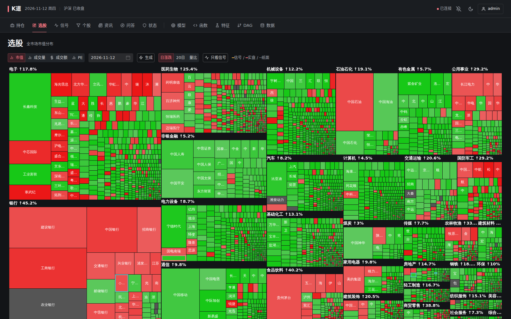
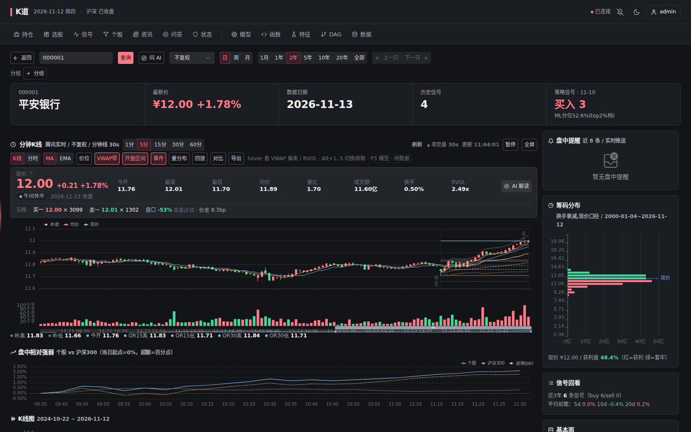
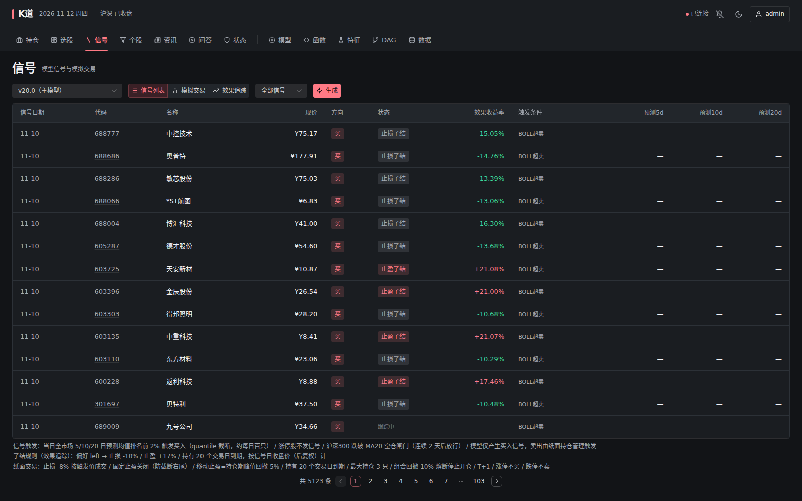
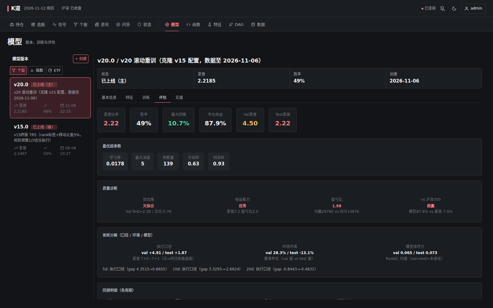
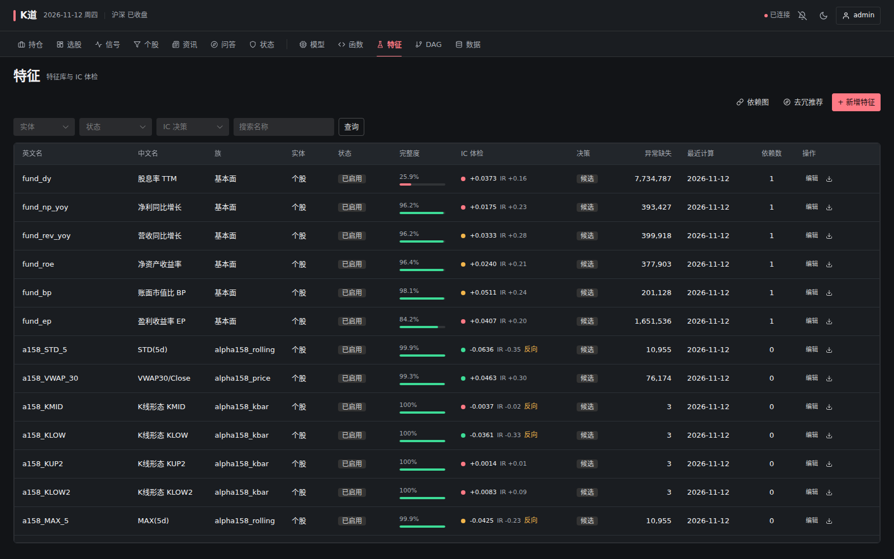
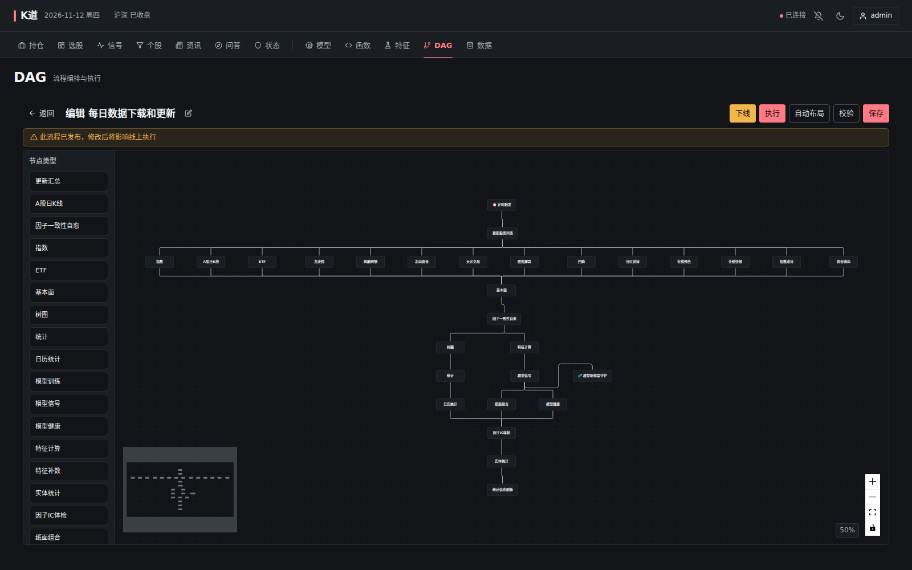
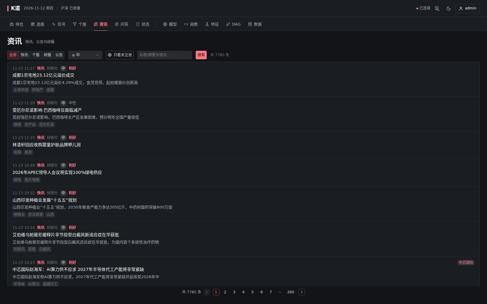
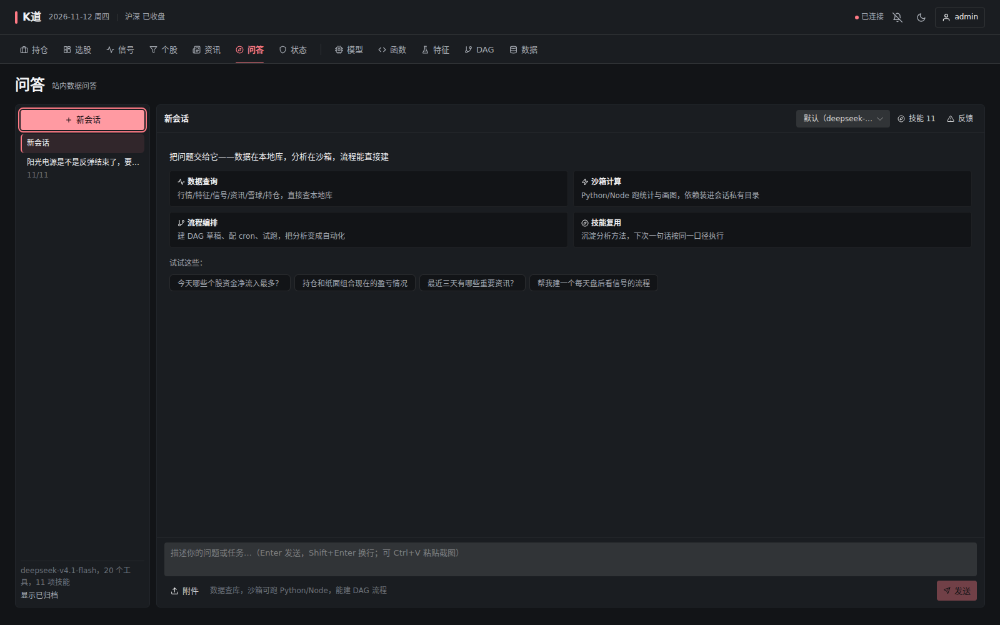
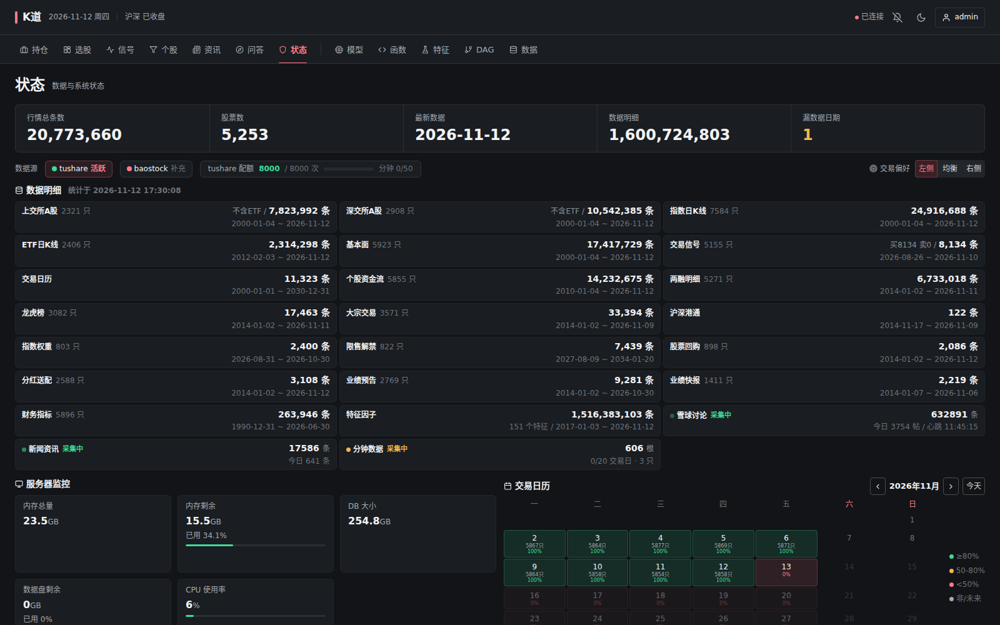
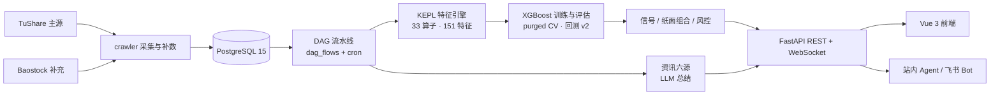

<div align="center">
  
  <h1>K道 · Stone</h1>
  <p><strong>A 股个股买卖点监测系统</strong></p>
  <p>全市场行情采集 · KEPL 特征引擎 · XGBoost 模型信号 · 回测与纸面组合 · 资讯情绪 · AI 问答</p>

  
  
  
  
  
</div>



## 项目简介

**K道（Stone）** 是一个面向个人投资者的本地 A 股量化研究与监测平台。它把「数据采集 → 数据治理 → 特征计算 → 模型训练/评估 → 信号生成 → 纸面交易 → 资讯与 AI 辅助」串成一条可复现的流水线，前端以树图、K 线、信号表和模型评估看板的形式呈现。

项目不是一套只用来跑回测的研究脚本，而是一个每天真实运行的系统：TuShare 按交易日采集全市场行情，DAG 流水线负责补齐、修复与计算，模型信号与纸面组合每日更新，异常与进度通过 WebSocket 推到浏览器。采集、特征、训练、回测共用同一套代码路径，尽量避免「研究环境一套、实盘一套」的口径漂移。

> 个人研究与工程实践项目，**不构成任何投资建议**。数据源、模型与交易规则均有各自的风险与局限，请独立判断。

## 功能概览

| 模块 | 能力 |
|---|---|
| **全市场行情** | TuShare 唯一主源，按交易日拉取 A 股 / 指数 / ETF 日线、基本面 22 字段、资金流、两融、龙虎榜、分红送配等；Baostock 补充 ROE / 营收净利 / ETF 复权与交易日历 |
| **树图选股** | 行业 / 概念分组，面积映射成交额或市值，颜色映射涨跌幅 / 换手 / 估值；支持日期回看与个股下钻 |
| **个股详情** | 分时与多周期 K 线、VWAP / 开盘区间、五档盘口、筹码分布、PE 分位、历史信号回看、盘中提醒、相关资讯、AI 解读 |
| **特征引擎** | KEPL 表达式（25 个时序算子 + 8 个截面算子）、截面中性化 `neut()`、Alpha158 因子库（114 因子）、151 个在用特征、IC 体检红绿灯、按年分区存储 |
| **模型训练** | XGBoost（GPU 优先）、多周期收益标签、purged time-series CV、多种子集成、Optuna 调参、walk-forward、置换检验 |
| **模型评估** | 回测引擎 v2（涨跌停 / T+1 / 延迟结算 / 佣金 / 冲击成本）、RankIC、分层净值、Val-Test 差距三分解、基准环境对照 |
| **信号与交易** | 多周期模型均值 + 规则过滤生成每日信号；纸面组合、TopkDropout 换仓、止盈止损、风控规则与告警 |
| **DAG 调度** | 数据库编排的动态流程（`dag_flows`）、cron 触发、拓扑并行、节点级日志、历史补数断点续传、TuShare 配额预算 |
| **资讯与情绪** | 六源资讯采集（财联社 / 东财 / 华尔街见闻 / 研报 / 巨潮公告 / 雪球），LLM 逐条总结摘要、重要度、主题与情绪，关联关注池个股 |
| **AI 助手** | 站内 ReAct Agent（只读 SQL、个股全景、资讯检索、Python/Node 沙箱、DAG 构建）+ 飞书 Bot 对话 |
| **数据治理** | 数据完整度、复权因子一致性自愈、零价停牌修复、模型数据漂移血缘、配额监控、WebSocket 实时状态 |

## 界面预览

### 全市场树图

按行业与概念聚合全市场，面积代表成交额 / 市值，颜色代表涨跌幅 / 换手 / 估值。用于快速感知市场结构，点击可直接进入个股详情。


### 个股详情与盘中监测

分时、K 线、VWAP、开盘区间、盘口五档、筹码分布、PE 分位、信号回看与相关资讯集中在同一页；盘中提醒与异动规则通过 WebSocket 实时推送。



### 信号中心

模型多周期预测汇总为每日买卖信号，支持信号列表、模拟交易与效果追踪。每条信号记录触发条件、到期状态与真实收益率，便于复盘模型在实盘环境下的表现。



### 模型训练与评估

训练侧支持 purged time-series CV 与多种子集成；评估侧提供回测指标、最优超参、质量诊断，以及 **Val-Test 差距三分解**（执行口径 / 市场环境 / 模型排序力），用于区分「模型退化」与「口径或环境变化」。



### KEPL 特征库

KEPL 用表达式描述因子，例如 `rank(ts_mean(close, 20))`、`neut(pe_ttm)`。特征库提供完整度、IC / IR、异常缺失与依赖关系视图；Alpha158 因子与自研特征统一管理、统一计算。



### DAG 数据流水线

流程由数据库动态编排，Vue Flow 可视化编辑。每日主流程覆盖行情、指数、ETF、基本面、资金流、两融、因子自愈、特征计算、模型信号、纸面组合、健康检查、统计与一致性校验，支持并行拓扑执行与节点级日志。



### 资讯与情绪

六个公开数据源采集快讯、个股新闻、研报与公告；LLM 逐条生成摘要、重要度（1–3）、主题与情绪。关注池个股会自动关联资讯，雪球讨论帖单独做情绪打分。



### AI 问答 Agent

站内 Agent 采用 ReAct 多轮「思考 → 工具 → 观察」：可直接查询本地数据库、读取表结构、生成个股全景、检索资讯、在沙箱里运行 Python/Node，甚至创建 DAG 流程。技能体系（`skills/<name>/SKILL.md`）让分析方法可以沉淀并复用。



### 数据治理与可观测

状态页汇总行情条数、覆盖股票数、数据明细、数据源健康、TuShare 配额、内存 / CPU / 磁盘、交易日历与各表完整度。复权因子自愈、零价修复、特征重算与模型训练事件都会写入数据血缘台账。



## 系统架构



**数据流简述：**

1. **采集**：按交易日拉取全市场日线、指数、ETF、基本面与扩展数据；失败任务可重试，历史补数按日期断点续传，并受 TuShare 配额预算约束。
2. **治理**：`factor_heal` 检测复权因子回溯性重定基造成的假跳变，重写 `close_hfq` 并重算受污染窗口的特征；停牌零价行会被修复或丢弃，不进入估值与特征宽表。
3. **特征**：KEPL 编译为 pandas 计算图，支持 lookback 扩展、截面函数与中性化，结果以 COPY 流式写入按年分区的 `feature_values`。
4. **模型**：多周期收益标签 → 预处理 → purged CV / 集成训练 → 回测与 RankIC 评估 → 激活模型 → 每日信号。
5. **呈现**：REST API 与 WebSocket 推送任务、配额、补数进度、风控告警与盘中提醒；前端通过 hash 路由组织十余个页面。

## 技术栈

| 层次 | 技术 |
|---|---|
| 后端 | Python 3.11 · FastAPI · SQLAlchemy Core（原生 SQL，无 ORM）· Pydantic Settings |
| 数据库 | PostgreSQL 15（asyncpg 异步 + psycopg2 同步双引擎）· Redis（可选，飞书会话历史） |
| 数据源 | TuShare（主源，配额计数）· Baostock（字段补充器 / 交易日历） |
| 特征与表达式 | KEPL（Lark LALR(1) 解析器）· pandas / NumPy · Alpha158 |
| 机器学习 | XGBoost（CUDA 优先）· LightGBM（DoubleEnsemble 实验）· Optuna · scikit-learn |
| 回测 | 自研回测引擎 v2（撮合 / 账户 / 绩效三层）· TopkDropoutStrategy · walk-forward |
| 前端 | Vue 3 · Vite 5 · Pinia · Naive UI · ECharts · Vue Flow · Monaco Editor |
| AI | DeepSeek（Function Calling）· 站内 ReAct Agent · 飞书 Bot |
| 调度与部署 | 自研 DAG 执行器 · cron 调度 · Docker Compose（可选）· Uvicorn |

## 快速开始

### 环境要求

- Python **3.11+**
- Node.js **18+**
- PostgreSQL **15+**（必需）
- Redis 7（可选）
- TuShare Token（从 [tushare.pro](https://tushare.pro) 申请；没有 token 时界面可浏览，但无法采集新数据）

### 1. 准备数据库

```bash
# 创建数据库与用户（按需调整密码）
psql -U postgres -c "CREATE USER stock WITH PASSWORD 'stock123';"
psql -U postgres -c "CREATE DATABASE stock_monitor OWNER stock;"
```

### 2. 启动后端

```bash
git clone https://github.com/yeqisong/stone.git
cd stone

python3.11 -m venv venv
source venv/bin/activate
pip install -r requirements.txt

cp .env.example .env
# 编辑 .env，至少配置：
#   DATABASE_URL / DATABASE_URL_SYNC
#   LOGIN_PASSWORD
#   TUSHARE_TOKEN
#   APP_SECRET_KEY（生产环境务必修改）

uvicorn app.main:app --host 0.0.0.0 --port 8000
```

首次启动会自动执行 `init_db`：建表、幂等迁移、写入内置算子 / 系统特征 / 默认策略配置。数据库为空时不会自动补历史数据，需要在「状态」页发起补数，或运行 DAG 流程「每日数据下载和更新」。

### 3. 启动前端

```bash
cd web-v2
npm install
npm run dev
```

打开 <http://localhost:3000>，使用 `.env` 中的 `LOGIN_USERNAME` / `LOGIN_PASSWORD` 登录。Vite 开发服务器默认把 `/api` 代理到 `localhost:8000`。

### 4. 常用命令

```bash
# 单元测试 / 集成测试
pytest tests/unit/ -v
pytest tests/integration/ -v

# 前端构建
cd web-v2 && npm run build

# 可选：Docker 启动（PostgreSQL + 应用）
docker compose up -d
```

> **TuShare 配额提示**：免费 / 低积分账号的调用额度有限（本系统按 50 次/分、8000 次/天做预算）。首次全量补数耗时较长，建议先小范围验证，再使用断点续传逐步补齐。

## 数据流水线

```
TuShare 按交易日全市场拉取
        │
        ▼
PostgreSQL ──► DAG 动态流程（cron 触发）
        ├─ kline / index / etf / stock_master
        ├─ factor_heal（复权因子自愈）
        ├─ feature_compute（KEPL → feature_values）
        ├─ model_signal / model_health
        ├─ paper_portfolio（纸面组合）
        ├─ treemap / stats / completeness
        ├─ news_crawl / news_summary（每 20 分钟）
        └─ macro_daily（宏观与指数估值）
        │
        ▼
FastAPI REST + WebSocket ──► Vue 3 前端 / 站内 Agent / 飞书 Bot
```

**设计约束（工程约定）：**

- 停牌或缺少行情时沿用最近有效价估值，**不按 0 或成本价估值**；零价行不进入特征宽表。
- 模型预处理、标签构建与回测只允许走 `scripts/pipeline.py` 的模块级函数，训练与复评共用同一实现。
- 模型评估口径可复现：`eval_version.py` 对已训练模型重跑评估，`--end` 可钉死窗口做对照。
- 数据源调用统一经配额计数器；补数任务支持分批提交与取消。

## 目录结构

```
stone/
├── app/                 # FastAPI 后端：API、认证、DAG、任务、风控、AI、飞书
│   ├── api/             # REST 路由（行情 / 信号 / 模型 / 特征 / 资讯 / Agent / DAG...）
│   ├── db/              # 双引擎连接 + DDL + init_db 幂等迁移
│   ├── kepl/            # KEPL 解析器与函数实现
│   ├── agent/           # 站内 ReAct Agent、工具、沙箱、技能
│   └── ai/ feishu/      # DeepSeek 客户端与飞书 Bot
├── crawler/             # TuShare / Baostock 适配器、补数、写库、资讯采集
├── scripts/             # DAG 节点函数、特征计算、模型训练/评估、调度
├── strategy/            # 技术指标、策略、回测引擎 v2、DoubleEnsemble
├── web-v2/              # Vue 3 + Vite 前端
├── tests/               # unit / integration / e2e
├── design/              # 架构、模块、API、前端、资讯等设计文档
├── skills/              # 内置 Agent 技能（SKILL.md）
└── docs/                # 三方库笔记与界面截图
```

## 设计文档

| 文档 | 内容 |
|---|---|
| [01 系统架构](design/01-系统架构.md) | 系统定位、技术栈、架构图、启动流程、数据表、认证与部署 |
| [02 模块功能与数据流程](design/02-模块功能与数据流程.md) | 各模块职责、TaskManager / DAG / 特征引擎 / 回测引擎机制 |
| [03 API 接口文档](design/03-API接口文档.md) | HTTP 端点与 WebSocket 消息协议 |
| [04 前端架构与页面](design/04-前端架构与页面.md) | 路由、Pinia Store、页面组件、主题与实时推送 |
| [05 Qlib 移植设计](design/05-Qlib移植设计.md) | 回测引擎 v2、TopkDropout、绩效报告、Alpha158 |
| [06 雪球情绪采集](design/06-雪球情绪采集设计.md) | 讨论帖采集、调度、LLM 情绪打分 |
| [07 新闻资讯模块](design/07-新闻资讯模块设计.md) | 六源采集、幂等、LLM 总结与重要度分层 |
| [08 Agent 问答页](design/08-Agent问答页v2优化.md) | 站内 Agent 的交互与运行时设计 |

## 说明

- 本项目为个人学习与研究项目，**不构成投资建议**，也不承诺任何收益。
- 数据来自 TuShare、Baostock 及各公开资讯接口，使用时请遵守对应数据源的服务条款与配额限制。
- 模型、回测与信号均存在过拟合、数据偏差与执行偏差风险；任何实盘决策请自行评估并承担风险。
- 仓库中的截图来自本地运行实例，数据随交易日更新，实际界面以当前代码为准。
